<div align="center">


<a href="https://git.io/typing-svg">
  
</a>

<sub>📍 Ankara, Türkiye 🇹🇷 &nbsp;·&nbsp; Originally from Caracas, Venezuela 🇻🇪</sub>

<br/><br/>

<a href="https://www.linkedin.com/in/juan-ron-7506a3292"></a>
<a href="mailto:juanronmolina@gmail.com"></a>
<a href="https://github.com/juandronm"></a>


<br/><br/>


</div>

<br/>

## `01` &nbsp;About

I'm a Computer Engineering student who lives at the intersection of computer vision and applied ML — training and deploying models that run on real camera streams, not just notebooks.

```yaml
role:          Computer Vision Engineer @ YourEye Technologies
studying:      B.Sc. Computer Engineering, Gazi University (Grad: Jul 2027)
building_now:  YOLO-based detection pipelines · GPU-optimized inference
learning_now:  Advanced Deep Learning · LLM/RAG integration · ML deployment at scale
open_to:       Open-source CV/ML collaborations · research mentorship
languages:     🇪🇸 Native · 🇺🇸 Bilingual · 🇹🇷 Professional · 🇫🇷 Basic
```

<br/>

## `02` &nbsp;Stack

<table>
<tr>
<td width="200"><sub><b>CORE LANGUAGES</b></sub></td>
<td>
<picture>
  <source media="(prefers-color-scheme: dark)" srcset="https://skillicons.dev/icons?i=python,c,cpp,java,cs,html,css&theme=dark" />
  
</picture>
</td>
</tr>
<tr>
<td><sub><b>ML & COMPUTER VISION</b></sub></td>
<td>
<picture>
  <source media="(prefers-color-scheme: dark)" srcset="https://skillicons.dev/icons?i=tensorflow,pytorch,opencv&theme=dark" />
  
</picture>


</td>
</tr>
<tr>
<td><sub><b>WEB & DATABASES</b></sub></td>
<td>
<picture>
  <source media="(prefers-color-scheme: dark)" srcset="https://skillicons.dev/icons?i=react,vite,flask,mysql,postgresql&theme=dark" />
  
</picture>
</td>
</tr>
<tr>
<td><sub><b>SYSTEMS, CLOUD & TOOLING</b></sub></td>
<td>
<picture>
  <source media="(prefers-color-scheme: dark)" srcset="https://skillicons.dev/icons?i=linux,bash,gcp,git,github,jupyter,docker&theme=dark" />
  
</picture>
</td>
</tr>
</table>

<br/>

## `03` &nbsp;Featured work

<table>
<tr>
<td width="50%" valign="top">

#### 🎥 Computer Vision @ YourEye
CV modules deployed on live security-camera streams — face recognition (InsightFace: RetinaFace + ArcFace ResNet-50), object detection with YOLO, RTSP ingestion, Docker + CUDA for deployment.

    

</td>
<td width="50%" valign="top">

#### 🕒 officeTimeTracker
YOLO-based pose detection system for tracking office presence, built through a full Docker (PyTorch + Ultralytics) pipeline with GPU execution on Colab.

   

</td>
</tr>
<tr>
<td width="50%" valign="top">

#### 🗣️ Personal Voice Assistant
A voice assistant built around Hugging Face TTS/STT models — handled model-compatibility debugging and speech pipeline wiring end to end.

  

</td>
<td width="50%" valign="top">

#### 🎮 MiKuri
A Pokémon-style 2D game built in JavaFX — sprite-based movement, battle system, and game-state logic from scratch.

 

</td>
</tr>
</table>

<div align="center"><sub><i>More on <a href="https://github.com/juandronm">GitHub →</a></i></sub></div>

<br/>

## `04` &nbsp;Activity

<table align="center">
<tr>
<td valign="top" width="49%">
  
</td>
<td valign="top" width="42%">
  
  
</td>
</tr>
</table>

<picture>
  <source media="(prefers-color-scheme: dark)" srcset="./assets/week-by-week-dark.svg" />
  
</picture>

<br/>

## `05` &nbsp;Certifications

| Certificate | Issuer | Date |
| :--- | :--- | ---: |
| **Claude Code 101** | Anthropic | Jun 2026 |
| **Machine Learning A-Z** | SuperDataScience | Sep 2025 |
| **The Complete Python Pro Bootcamp** | The London App Brewery | Aug 2025 |
| **Google Cloud Skills Boost** | Google | Aug 2025 |
| **Introduction to Data Science** | Cisco | Mar 2025 |

<br/>

<div align="center">


<br/><br/>

<i>"Building intelligent systems, one commit at a time."</i>

<br/><br/>

📬 **Reach out:** <a href="mailto:juanronmolina@gmail.com">juanronmolina@gmail.com</a> · +90 506 471 13 78


</div>
